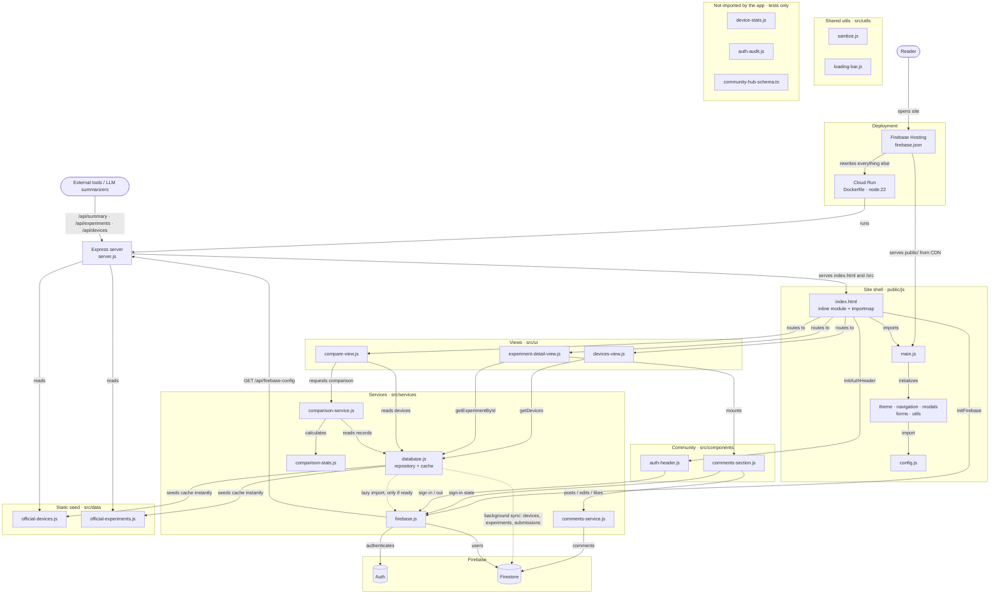

# Architecture

Traced from the actual `import` statements, `index.html`, the `server.js` routes, `firebase.json` and the `Dockerfile` (v6.3.2, 2026-10-12). Every arrow maps to a line of code. Dashed arrows are optional at runtime.

When you add, remove or rewire a module, update this diagram in the same PR.

## Notes

- **`database.js` works without Firebase.** It fills its cache from `src/data/official-*.js` on load. It then imports Firebase lazily and syncs `devices`, `experiments` and `submissions` in the background, but only if Firebase is ready.
- **The browser makes one call to the server: `/api/firebase-config`.** The `/api/summary`, `/api/experiments` and `/api/devices` routes are read-only APIs for external tools.
- **`index.html` is the bootstrap.** Its inline module loads the views, the auth header and Firebase. `main.js` only sets up the shell managers.
- **`sanitize.js` and `loading-bar.js` are client utilities.** They are imported by the views, the comments, `database.js` and the auth header. Their edges are left out of the diagram to keep it readable.
- **Not imported by the app:** `src/services/device-stats.js`, `src/services/auth-audit.js` and `src/types/community-hub-schema.ts`. Only the test scripts reference them.
- **`/api/submit` stores nothing.** It validates the input and, when `RESEND_API_KEY` and `CONTACT_TO_EMAIL` are set, emails the submission through Resend (`200`, `delivered: true`; `502` if Resend fails). Without them it returns `202` with `delivered: false`, and the contact form opens a mailto: draft instead. See the README's "Contact form email" section.
